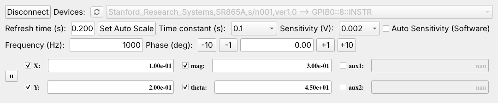
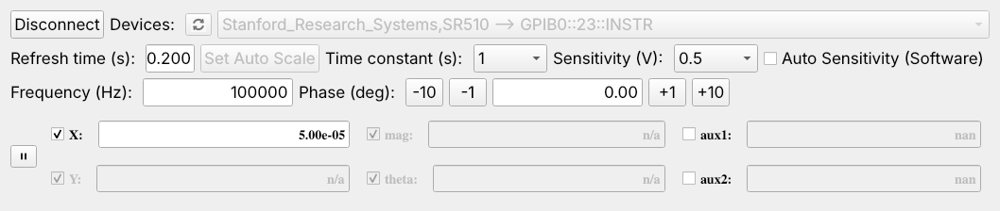

# pySRSLockin

```pySRSLockin``` is a Python library/GUI interface to control lock-in amplifiers made by Stanford Research Systems (SRS). Different models are accessed with the same commands, so the same code can be used with any of the supported models. The package is composed of two parts, a low-level driver to perform basic operations, and a high-level GUI, written with PyQt5, which can be easily embedded into other GUIs.

The interface can work either as a stand-alone application, or as a module of [ergastirio](https://github.com/MicheleCotrufo/ergastirio).

Currently supported models: **SR865A**, **SR844**, **SR810**, **SR510**.

## Table of Contents
 - [Installation](#installation)
 - [Supported models](#supported-models)
 - [Usage via the low-level driver](#usage-via-the-low-level-driver)
   * [Creating a driver instance](#creating-a-driver-instance)
   * [Indexing of time constants and sensitivities](#indexing-of-time-constants-and-sensitivities)
   * [Properties](#properties)
   * [Other attributes](#other-attributes)
   * [Methods](#methods)
   * [Examples](#examples)
 - [Usage as a stand-alone GUI interface](#usage-as-a-stand-alone-gui-interface)
 - [Embed the GUI within another GUI](#embed-the-gui-within-another-gui)

## Installation

Use the package manager pip to install,

```bash
pip install pysrslockin==1.0.0rc1
```
(the SR510 is supported starting from the version after 0.22).

This will install ```pySRSLockin``` together with all the libraries listed in the ```requirements.txt``` file,
```bash
abstract_instrument_interface>=0.9
PyQt5>=5.15.6
pyqtgraph
pyvisa
numpy
```
Only `pyvisa` is needed to use the low-level driver. If PyQt5 is not installed, `import pySRSLockin` still works, but the GUI classes (`pySRSLockin.interface`, `pySRSLockin.gui`) are not available.

A VISA backend (e.g. [NI-VISA](https://www.ni.com/en/support/downloads/drivers/download.ni-visa.html)) is required to communicate with the instruments.

## Supported models

The driver hides the differences between models (different commands, ranges, and ways of indexing time constants and sensitivities). Features that a model does not provide raise a `RuntimeError` when accessed; the property `supported_outputs` and the method `supports_property()` can be used to check in advance.

| | SR865A | SR844 | SR810 | SR510 |
| --- | --- | --- | --- | --- |
| Identification | `*IDN?` | `*IDN?` | `*IDN?` | Probing with read-only commands (the SR510 does not support `*IDN?`) |
| Outputs | X, Y, mag, theta, aux1, aux2 | X, Y, mag, theta, aux1, aux2 | X, Y, mag, theta, aux1, aux2 | X, aux1, aux2 (single-phase lock-in) |
| Simultaneous reading of outputs (`SNAP?`) | Yes (up to 3 at once) | No (outputs read one by one) | Yes (up to 6 at once) | No |
| Sensitivities | 1 nV - 1 V (28) | 100 nV - 1 V (15) | 2 nV - 1 V (27) | 10 nV - 500 mV (24), or 100 nV - 500 mV (21) without preamplifier |
| Time constants | 1 µs - 30 ks (22) | 100 µs - 30 ks (18) | 10 µs - 30 ks (20) | 1 ms - 100 s (11, pre-filter) |
| Set frequency | Yes (internal reference only) | Yes (internal reference only) | Yes (internal reference only) | No (read-only) |
| Set phase | Yes | Yes | Yes | Yes |
| Auto scale / auto gain | Yes (`ASCL`) | Yes (`AGAN`) | Yes (`AGAN`) | No |

**Notes on the SR510.**
* By default, devices on serial ports are not scanned. An SR510 connected via RS-232 can be connected directly with `connect_device(address, model='SR510')`. The serial port is configured with 9600 baud, 8 data bits, 2 stop bits, no parity, and the echo mode of the SR510 must be off (rear-panel switches).
* The X output is read from the output display of the SR510 (command `Q`), after setting the display to X. The value therefore includes the effect of offset and expand, if they are on.
* Upon connection, the SR510 is set to remote mode (front panel locked). It is set back to local mode upon disconnection.

## Usage via the low-level driver

`pySRSLockin` provides a low-level driver, based on the library `pyvisa`, to directly interface with the lock-in amplifier.

```python
from pySRSLockin.driver import SRS_Lockin
lockin = SRS_Lockin()
available_devices = lockin.list_devices()
print(available_devices)
lockin.connect_device(device_addr = available_devices[0][0])
print(lockin.X)
lockin.disconnect_device()
```
The method `list_devices()` returns a list, with each element representing one available device in the format `[address,identity,model]`. The string `address` contains the physical address of the device. The line `lockin.connect_device(device_addr = available_devices[0][0])` establishes a connection to the first device found. We then print the X output currently read by the lock-in, and finally disconnect from it.

The class `SRS_Lockin` supports several properties and methods to communicate with the lock-in and to read/change its settings. Some of the properties are read-only, while others can be set. A full list of properties, attributes, and methods is available below. **Note**: the documentation below was partially compiled with the help of Claude - mistakes are possible.

### Creating a driver instance

```python
SRS_Lockin(model=None, only_new_models=False, scan_serial_ports=False, timeout_ms=2000)
```

| Parameter | Type | Description |
| --- | --- | --- |
| `model` | str, optional | If specified, `list_devices()` only looks for devices of this model (`'SR865A'`, `'SR844'`, `'SR810'` or `'SR510'`). Raises `RuntimeError` if an unsupported model name is passed. |
| `only_new_models` | bool, optional | The SR510 does not answer `*IDN?`, and is identified by sending a few read-only SR510 commands to any device that times out on `*IDN?`. This slows down `list_devices()`. If `True`, the SR510 is not searched for. Default is `False`. |
| `scan_serial_ports` | bool, optional | If `True`, `list_devices()` also scans serial ports (`ASRL` resources). Default is `False`. |
| `timeout_ms` | int, optional | VISA timeout (in ms) used for all communications. Default is 2000. |

### Indexing of time constants and sensitivities

The properties `time_constants` and `sensitivities` are lists of the values (in seconds and volts) available on the connected device. The properties `time_constant` and `sensitivity` are integers, corresponding to the **position** of the current value in these lists. For the SR865A, SR844 and SR810 the position coincides with the integer code used by the instrument (note that for the SR865A the sensitivities are in decreasing order, `0` = 1 V). For the SR510, whose codes start from 1 (and depend on the presence of the preamplifier), the driver converts between positions and instrument codes internally.

To work directly with physical values, use `time_constant_value` and `sensitivity_value`.

### Properties

The following are implemented as Python `@property`, i.e. they are accessed without parentheses (e.g. `lockin.X`) and, when settable, assigned with `=` (e.g. `lockin.phase = 45`). Reading or setting any of these requires a device to be connected, otherwise a `RuntimeError` is raised. Accessing a property that is not supported by the connected model also raises a `RuntimeError`.

| Property | Type | Description | Can be set? | Notes |
| --- | --- | --- | --- | --- |
| `X` | float | In-phase output (V). | No | |
| `Y` | float | Quadrature output (V). | No | Not available on the SR510. |
| `mag` | float | Magnitude R (V). | No | Not available on the SR510. |
| `theta` | float | Phase of the signal θ (deg). | No | Not available on the SR510. |
| `aux1`, `aux2` | float | Voltage (V) at the auxiliary inputs 1 and 2. | No | |
| `supported_outputs` | list of str | Outputs provided by the connected model, among `['X','Y','mag','theta','aux1','aux2']`. | No | E.g. `['X','aux1','aux2']` for the SR510. |
| `frequency` | float | Reference frequency (Hz). | Yes | Setting it is only effective with the internal reference, and not possible on the SR510. Read it back after setting it to check the value actually applied. |
| `phase` | float | Reference phase shift (deg). | Yes | The instrument may wrap the value into its own range. |
| `time_constants` | list of float | Time constants (s) available on the connected device. | No | |
| `time_constant` | int or None | Index (position in `time_constants`) of the current time constant. `None` if it could not be read. | Yes | Setting an index outside `0 ... len(time_constants)-1` raises `ValueError`. |
| `time_constant_value` | float or None | Current time constant (s). | Yes | When set, the available time constant closest (on a log scale) to the given value is selected. A value <= 0 raises `ValueError`. |
| `sensitivities` | list of float | Full-scale sensitivities (V) available on the connected device. | No | For the SR510 without preamplifier, sensitivities below 100 nV are not included. |
| `sensitivity` | int or None | Index (position in `sensitivities`) of the current sensitivity. `None` if it could not be read. | Yes | Setting an index outside `0 ... len(sensitivities)-1` raises `ValueError`. |
| `sensitivity_value` | float or None | Current full-scale sensitivity (V). | Yes | When set, the smallest available sensitivity >= the given value is selected (the largest one, if the value exceeds all of them). |
| `status_byte` | int | Raw status byte (`*STB?`, or `Y` for the SR510). | No | The meaning of each bit is model-dependent (see the manuals). On the SR510, reading it also clears it. |

### Other attributes

These are plain instance or class attributes (not `@property`) that are also useful to read directly.

| Attribute | Type | Description |
| --- | --- | --- |
| `connected` | bool | `True` if a device is currently connected, `False` otherwise. |
| `model` | str or None | Model of the device currently connected (e.g. `'SR510'`), or `None` if not connected. |
| `model_user` | str or None | Model passed to the constructor (if any). |
| `instrument` | pyvisa resource | VISA resource of the connected device. Defined only after a successful connection. |
| `list_valid_devices` | list | Result of the last call to `list_devices()`. |
| `list_supported_models` | list of str | Names of all supported models. |
| `model_identifiers` | list | Class attribute. List of `[model_name, idn_substring]` pairs used to recognize a device's model from its `*IDN?` response. |
| `mapping_properties` | dict | Class attribute. `{property_name: {model: command}}`: commands used for each property and model. A model missing from the inner dictionary does not support that property. |
| `output_names` | list of str | Class attribute. `['X','Y','mag','theta','aux1','aux2']`. |

### Methods

| Method | Returns | Description |
| --- | --- | --- |
| `list_devices()` | list | Returns a list of all available devices. Each element is a three-element list `[address, identity, model]`. `address` is the VISA address of the device, `identity` is its answer to `*IDN?` (`'Stanford_Research_Systems,SR510'` for the SR510), and `model` is the model name. Serial ports are scanned only if `scan_serial_ports=True`. If `model` was set when creating the driver, only devices of that model are returned. |
| `connect_device(device_addr: str, model: str = None)` | (str,int) | Connect to the device at the address `device_addr`. If `model` is not given, the model is taken from the last scan (a new scan is run if needed); if `model` is given, no scan is run. In both cases the identity of the device is verified. Returns a tuple: the first element is the identity of the device or an error message, the second element is 1 if the connection was successful, 0 otherwise. Raises `RuntimeError` if a device is already connected, and `ValueError` if the address is not a valid device (or `model` is not supported). |
| `disconnect_device()` | (str,int) | Disconnect the connected device (after setting it back to local mode). Returns a tuple: a message, and 1 if the disconnection was successful, 0 otherwise. Raises `RuntimeError` if no device is connected. |
| `read_outputs(names: list)` | dict | Read several outputs (e.g. `['X','Y']`) and return `{name: value}`. On the SR865A and SR810 the values are acquired at the same instant (`SNAP?`); on the other models they are read one by one. Raises `RuntimeError` if any output is not provided by the connected model. |
| `supports_property(prop: str)` | bool | `True` if the connected model supports `prop`, a key of `mapping_properties` (e.g. `'Y'`, `'frequency_SET'`, `'phase_SET'`, `'auto_sensitivity'`). |
| `set_auto_scale()` | int | Run the auto-scale (SR865A) or auto-gain (SR844, SR810) function of the instrument. Returns 1 if the command was sent, 0 if it failed or if the model does not have this function (SR510). |
| `check_valid_connection()` | None | Raises `RuntimeError` if no device is connected. |
| `check_if_valid_old_SRS_instrument(instrument)` | list or None | Check whether an open pyvisa resource is an SR510, by sending read-only commands and checking the answers. Used internally by `list_devices()` and `connect_device()`. |

### Examples
```python
from pySRSLockin.driver import SRS_Lockin
lockin = SRS_Lockin()
available_devices = lockin.list_devices()           # Check which devices are available
print(available_devices)
lockin.connect_device(device_addr = available_devices[0][0])   # Connect to the first available device
print(lockin.model)                                  # Model of the connected device
print(lockin.supported_outputs)                      # Outputs provided by this model

print(lockin.X)                                      # Read a single output
print(lockin.read_outputs(lockin.supported_outputs)) # Read all outputs (simultaneously, if supported)

print(lockin.frequency, lockin.phase)                # Read frequency and phase
lockin.phase = 45                                    # Set the phase
if lockin.supports_property('frequency_SET'):
    lockin.frequency = 1000                          # Set the frequency (internal reference only)

print(lockin.sensitivities)                          # Available sensitivities (V)
print(lockin.sensitivity, lockin.sensitivity_value)  # Current sensitivity (index and value)
lockin.sensitivity_value = 1e-3                      # Select the smallest range >= 1 mV
print(lockin.time_constants)                         # Available time constants (s)
lockin.time_constant = 2                             # Select the 3rd time constant of the list
lockin.time_constant_value = 0.1                     # Select the time constant closest to 100 ms

lockin.set_auto_scale()                              # Auto gain (returns 0 if not supported)
lockin.disconnect_device()                           # Disconnect the device
```

Connecting directly to a device with a known address and model (no scan, works also on serial ports):
```python
from pySRSLockin.driver import SRS_Lockin
lockin = SRS_Lockin()
msg, ID = lockin.connect_device('GPIB0::23::INSTR', model='SR510')
if ID == 1:
    print(lockin.X)
    lockin.disconnect_device()
```

## Usage as a stand-alone GUI interface
The installation sets up an entry point for the GUI. Just typing
```bash
pySRSLockin
```
in the command prompt will start the GUI (add `-s` to reduce the verbosity of the logs).



The GUI shows the available devices (refresh button next to the list), and allows to:
* select which outputs are read continuously (checkboxes next to each output), and the refresh time;
* start/pause the continuous reading (button on the left);
* select time constant and sensitivity, run the auto-scale/auto-gain of the instrument, or enable a software-controlled auto-sensitivity, which keeps the signal amplitude (mag, or |X| for the SR510) between 20% and 80% of the full scale;
* read and set the reference frequency and phase (type a value and press Enter), and change the phase by ±1 or ±10 degrees with the buttons next to it.

Frequency and phase are read at most once per second during continuous reading. The settings (refresh time, outputs to read, software auto-sensitivity) are saved in the file `config.json` when the GUI is closed.

The GUI adapts to the connected model: outputs, functions and settings that are not available are disabled. For example, with an SR510 only X, aux1 and aux2 can be read, the auto-scale button is disabled, and the frequency cannot be edited:



## Embed the GUI within another GUI
The GUI controller can also be easily integrated within a larger graphical interface, as shown in the example below.

```python
import PyQt5.QtWidgets as Qt  # QApplication, QWidget, QGridLayout, QLabel, QVBoxLayout
import pySRSLockin

app = Qt.QApplication([])
window = Qt.QWidget()

# The GUI needs to be contained inside a widget object
widget_containing_interface_GUI = Qt.QWidget()
widget_containing_interface_GUI.setStyleSheet(
    ".QWidget {\n"
    "border: 1px solid black;\n"
    "border-radius: 4px;\n"
    "}"
)

# Create the interface object for the lock-in
Interface = pySRSLockin.interface(app=app)
Interface.verbose = False  # set the verbosity of the interface logger to False
# At any time during the software execution, the data read by the instrument can be accessed via Interface.output,
# a dictionary with keys 'X', 'Y', 'mag', 'theta', 'aux1', 'aux2' (outputs not read are nan).
# Moreover, one could also set up a signal to automatically call another function whenever new data are read, by
#
#       Interface.sig_updated_data.connect(foo)
#
# Every time data are read from the instrument, the function foo is called and the dictionary Interface.output is passed as argument

# Create the GUI for the lock-in
view = pySRSLockin.gui(interface=Interface, parent=widget_containing_interface_GUI)

# Create additional GUI
gridlayoutwidget = Qt.QWidget()
gridlayout = Qt.QGridLayout()
gridlayout.addWidget(Qt.QLabel("Additional GUI 1"), 0, 0)
gridlayout.addWidget(Qt.QLabel("Additional GUI 2"), 1, 0)
gridlayout.addWidget(Qt.QLabel("Additional GUI 3"), 0, 1)
gridlayout.addWidget(Qt.QLabel("Additional GUI 4"), 1, 1)
gridlayoutwidget.setLayout(gridlayout)

layout = Qt.QVBoxLayout()
layout.addWidget(widget_containing_interface_GUI)
layout.addWidget(gridlayoutwidget)
layout.addStretch(1)
window.setLayout(layout)

app.aboutToQuit.connect(Interface.close)  # disconnect the device and save the settings when closing
window.show()
app.exec()  # Start the event loop.
```
